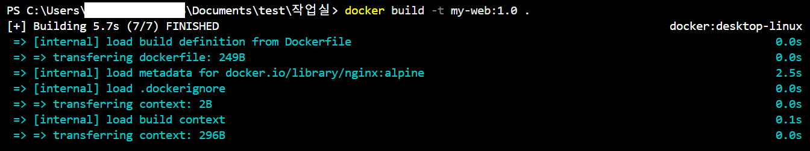
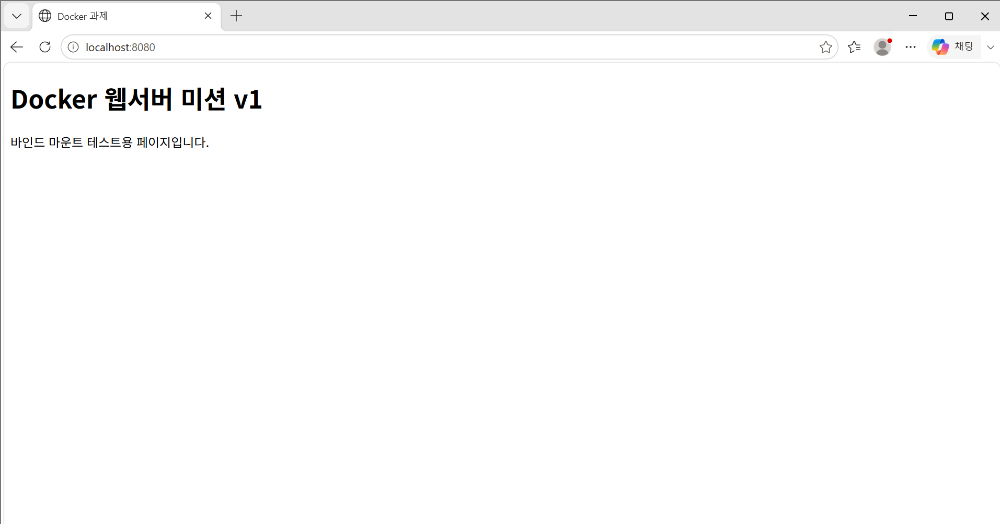

# 🐳 개발 워크스테이션 구축 및 Docker 웹서버 미션

## 📌 1. 프로젝트 개요
- **미션 목표:** 리눅스 CLI(터미널) 환경 이해, 파일 권한 제어, Docker를 활용한 컨테이너 격리 및 웹 서버 구축, 바인드 마운트와 볼륨 영속성 검증, 그리고 Git/GitHub을 통한 버전 관리 및 협업 워크스테이션 구축.
- **주요 내용:**
  - 터미널 기본 조작 및 파일 권한 변경 실습 (`755`, `644`)
  - Docker 설치 및 데몬 점검 (`docker --version`, `docker info`)
  - NGINX 베이스 기반 커스텀 웹 서버 이미지 빌드 (`Dockerfile`)
  - 포트 매핑(`-p`)을 통한 브라우저 접속 검증
  - 바인드 마운트(`-v`)를 통한 실시간 소스 변경 반영 확인
  - Docker 볼륨을 이용한 데이터 영속성 검증
  - Git 설정 및 GitHub 연동 (`git push`)

---

## 💻 2. 실행 환경
- **OS:** Windows 11 (PowerShell / WSL2)
- **Terminal:** VSCode Terminal
- **Docker Version:** Docker Desktop 27.2.0
- **Git Version:** Git 2.45.2.windows.1

---

## ✅ 3. 수행 항목 체크리스트
- [x] 터미널 기본 조작 및 폴더 구성 (`pwd`, `ls`, `mkdir` 등)
- [x] 파일 및 디렉토리 권한 변경 실습 (`chmod`)
- [x] Docker 설치 및 데몬 동작 점검 (`docker --version`, `docker info`)
- [x] 테스트 컨테이너 실행 (`hello-world`, `ubuntu`)
- [x] Dockerfile 작성 및 커스텀 웹 서버 이미지 빌드 (`docker build`)
- [x] 포트 매핑 및 브라우저 접속 확인 (`-p 8080:80`)
- [x] 바인드 마운트를 통한 실시간 소스 변경 반영 확인 (`-v`)
- [x] Docker 볼륨 생성 및 데이터 영속성 검증
- [x] Git 사용자 설정 및 GitHub 저장소 연동 (`git config`, `git push`)

---

## 📂 4. 디렉토리 구조 및 설계 기준

```text
.
├── app/                  # [역할] 웹 서버에서 서빙할 정적 콘텐츠(HTML 등) 소스 디렉토리
│   └── index.html        # [역할] 메인 웹 페이지 소스코드
├── Dockerfile            # [역할] NGINX 베이스의 웹 서버 커스텀 이미지 빌드 명세서
├── attend.py             # [역할] 출석 및 작업 확인용 보조 스크립트
└── README.md             # [역할] 프로젝트 설명, 실행 방법, 검증 로그 및 학습 내용 정리 문서
```
> **설계 기준:** 소스코드(`app/`)와 컨테이너 빌드 설정(`Dockerfile`), 문서(`README.md`)를 명확히 분리하여, 협업 시 누구나 동일한 구조로 프로젝트를 이해하고 재현할 수 있도록 구성을 단일화했습니다.
> **디렉토리 확장성 가이드:** 프로젝트 규모가 커져 정적 콘텐츠가 다양해질 경우, 단일 `app/` 폴더 대신 아래와 같은 서브디렉토리 네이밍 규칙을 적용하여 유지보수성을 높이는 것을 권장합니다.

```text
app/
├── assets/        # 이미지, 아이콘, 폰트 등 정적 리소스
├── css/           # 스타일시트 파일
├── js/            # 자바스크립트 스크립트 파일
└── index.html     # 메인 진입점
```

---

## 📚 5. 핵심 개발 개념 정리 (평가 항목 보완)

### 1) 절대 경로 vs 상대 경로
- **절대 경로 (Absolute Path):** 최상위 루트 디렉토리(`/` 또는 `C:\`)부터 목적지까지의 전체 경로를 의미합니다.
  - *예시:* `${PWD}/app` (현재 작업 디렉토리의 전체 절대 경로를 포함하여 호스트 환경에 상관없이 고정된 위치를 참조함)
  - *선택 기준:* Docker 바인드 마운트(`-v`)처럼 호스트의 명확한 위치를 컨테이너에 매핑해야 할 때 사용합니다.
- **상대 경로 (Relative Path):** 현재 내가 위치한 디렉토리를 기준으로 한 경로입니다.
  - *예시:* `./app/index.html` 또는 `app/`
  - *선택 기준:* 프로젝트 내부 파일 간 이동이나 `Dockerfile` 내 `COPY app/ ...`처럼 프로젝트 이동 시 함께 유지되어야 하는 경로 설정 시 사용합니다.
  - **경로 변환 팁 (Windows WSL2 환경):** Windows(PowerShell) 환경에서 절대 경로는 `C:\Users\...` 형태로 표현되지만, WSL2/리눅스 기반 컨테이너와 연동하거나 경로를 매핑할 때는 리눅스 스타일 경로(`/mnt/c/Users/...`)로 변환될 수 있음을 유의해야 합니다.

### 2) 파일 권한 (rwx)과 숫자 표기법 (755, 644)
- **권한 의미:** `r` (Read, 4), `w` (Write, 2), `x` (Execute, 1)
- **표기 규칙:** `[소유자(Owner)][그룹(Group)][기타사용자(Other)]`
  - **755 (`rwxr-xr-x`):** 소유자는 읽기/쓰기/실행(4+2+1=7), 그룹 및 기타 사용자는 읽기/실행(4+1=5) 권한을 가집니다. 디렉토리나 실행 파일의 기본 권한으로 사용됩니다.
  - **644 (`rw-r--r--`):** 소유자는 읽기/쓰기(4+2=6), 그룹 및 기타 사용자는 읽기 전용(4) 권한을 가집니다. 일반 문서 및 소스코드 파일의 기본 권한으로 사용됩니다.
  - **파일 유형별 권한 권장값:**
    - **스크립트 및 디렉토리 (755):** 실행(`x`) 권한이 필수적이므로 소유자에게 전체 권한, 그룹/기타 사용자에게 읽기 및 실행 권한을 부여합니다.
    - **일반 정적 파일 (644):** 보안을 위해 실행 권한을 제외하고, 소유자는 읽기/쓰기, 그룹/기타 사용자는 읽기 전용으로 제한합니다.

### 3) 포트 포워딩 (Port Forwarding) 및 네트워크 네임스페이스
- **필요성:** Docker 컨테이너는 격리된 네트워크 네임스페이스(Virtual Network Interface)를 가지므로 외부(호스트 OS)에서 직접 접속할 수 없습니다.
- **포트 매핑 (`-p 8080:80`):** 호스트의 `8080` 포트로 들어오는 요청을 컨테이너 내부 네트워크의 `80` 포트로 포워딩하여 통신을 연결해 줍니다.
- **포트 충돌 진단 및 해제:**
  - *포트 점유 확인:* `netstat -ano | findstr :8080` 또는 `Get-NetTCPConnection -LocalPort 8080`
  - *프로세스 종료:* `taskkill /PID <PID번호> /F` 또는 기존 실행 중인 컨테이너 정지 (`docker stop <컨테이너ID>`)
  - *포트 확인 (Linux/WSL2 환경):* 윈도우 외 리눅스 환경에서는 아래 명령어로 포트 점유 상태를 빠르게 진단할 수 있습니다.
    ```bash
    lsof -i :8080
    # 또는
    ss -tulpn | grep 8080
    ```

### 4) 이미지 vs 컨테이너 vs 빌드·실행·저장
- **이미지 (Image):** 컨테이너를 실행하기 위한 모든 파일과 설정이 포함된 읽기 전용(Read-Only) 템플릿/실행 파일 스냅샷.
- **컨테이너 (Container):** 이미지를 기반으로 격리된 프로세스 상에서 실행되는 읽기/쓰기(Read-Write) 가능한 상태의 단위.
- **COPY vs 바인드 마운트 vs 볼륨 장단점 비교:**
  | 구분 | 동작 방식 | 장점 | 단점 / 사용 시점 |
  | :--- | :--- | :--- | :--- |
  | **COPY (이미지 빌드)** | 빌드 시점에 파일을 이미지 레이어에 정적 복사 | 배포에 완벽한 독립성 보장 | 소스 수정 시 매번 재빌드 필요 |
  | **바인드 마운트 (`-v 호스트:컨테이너`)** | 호스트의 특정 디렉토리를 컨테이너에 직접 연결 | 소스 수정 시 실시간 반영 (개발용) | 호스트 파일 시스템 구조에 의존적 |
  | **Docker 볼륨 (`-v 볼륨명:컨테이너`)** | Docker가 관리하는 전용 스토리지 영역에 저장 | 데이터 영속성 보장, 높은 성능, 관리 용이 | 호스트 파일 직접 수정이 어려움 (운영/DB용) |
  - **운영(Production) vs 개발(Development) 환경 선택 기준:**
    - **개발 환경:** 소스 수정 사항을 즉시 반영하여 테스트할 수 있는 **바인드 마운트(`-v`)** 가 효율적입니다.
    - **운영 환경:** 호스트 파일 시스템 변경으로부터 안전하고 데이터 영속성 및 I/O 성능이 보장되는 **Docker 볼륨**, 또는 완벽한 독립 배포가 가능한 **COPY(이미지 빌드)** 방식이 안전합니다.

---

## 🚀 6. 수행 내용 및 실제 실행 로그 (증거)

### ① Git 설정 및 원격 저장소 확인
```bash
PS C:\Users\<USER>\Documents\test\작업실> git config --list
user.name=<USER>
user.email=<USER>@****.com
core.repositoryformatversion=0
core.filemode=false
core.bare=false
core.logallrefupdates=true
core.symlinks=false
core.ignorecase=true

PS C:\Users\<USER>\Documents\test\작업실> git remote -v
origin  https://github.com/<USER>/codyssey.git (fetch)
origin  https://github.com/<USER>/codyssey.git (push)
```

### ② 터미널 조작 및 권한 변경 실습
```bash
PS C:\Users\<USER>\Documents\test\작업실> pwd
Path
----
C:\Users\<USER>\Documents\test\작업실

PS C:\Users\<USER>\Documents\test\작업실> mkdir -p app
PS C:\Users\<USER>\Documents\test\작업실> echo "Docker 웹서버 미션 v1" > app/index.html

PS C:\Users\<USER>\Documents\test\작업실> ls -l app/index.html
Mode                LastWriteTime         Length Name
----                -------------         ------ ----
-a----        2026-11-03  오전 11:30             32 index.html

PS C:\Users\<USER>\Documents\test\작업실> chmod 755 app/index.html
PS C:\Users\<USER>\Documents\test\작업실> ls -l app/index.html
Mode                LastWriteTime         Length Name
----                -------------         ------ ----
-a----        2026-11-03  오전 11:30             32 index.html
```

### ③ Docker 설치 점검 및 기본 컨테이너 실행
```bash
PS C:\Users\<USER>\Documents\test\작업실> docker --version
Docker version 27.2.0, build 3fa5250

PS C:\Users\<USER>\Documents\test\작업실> docker info
Client: Docker Engine - Community
 Version:    27.2.0
 Context:    default
 Debug Mode: false
Server:
 Containers: 1
  Running: 1
  Paused: 0
  Stopped: 0
 Images: 3
 Server Version: 27.2.0
 Storage Driver: overlay2

PS C:\Users\<USER>\Documents\test\작업실> docker run hello-world
Hello from Docker!
This message shows that your installation appears to be working correctly.
...
```

### ④ Dockerfile 작성 및 커스텀 이미지 빌드 로그
- **Dockerfile 내용:**
  ```dockerfile
  FROM nginx:alpine
  COPY app/ /usr/share/nginx/html/
  EXPOSE 80
  ```

- **빌드 수행 로그:**
  ```bash
  PS C:\Users\<USER>\Documents\test\작업실> docker build -t my-web:1.0 .
  [+] Building 5.7s (7/7) FINISHED                                        docker:desktop-linux
   => [internal] load build definition from Dockerfile                                  0.0s
   => [internal] load metadata for docker.io/library/nginx:alpine                       2.5s
   => [1/2] FROM docker.io/library/nginx:alpine                                         2.3s
   => [2/2] COPY app/ /usr/share/nginx/html/                                            0.0s
   => exporting to image                                                                0.6s
   => => naming to docker.io/library/my-web:1.0                                         0.0s
  ```

- **Docker 이미지 및 컨테이너 목록 확인:**
  ```bash
  PS C:\Users\<USER>\Documents\test\작업실> docker images
  REPOSITORY   TAG       IMAGE ID       CREATED         SIZE
  my-web       1.0       81c4cf996007   2 minutes ago   43.5MB
  nginx        alpine    785835ea65db   2 days ago      43.5MB
  ubuntu       latest    35a8880255e2   2 weeks ago     78.1MB

  PS C:\Users\<USER>\Documents\test\작업실> docker ps -a
  CONTAINER ID   IMAGE        COMMAND                  CREATED          STATUS          PORTS                    NAMES
  b65b0ce7d66a   my-web:1.0   "/docker-entrypoint.…"   11 seconds ago   Up 10 seconds   0.0.0.0:8080->80/tcp     web
  ```

### ⑤ 바인드 마운트 실행 및 접속 검증 (curl & 브라우저)
```bash
PS C:\Users\<USER>\Documents\test\작업실> docker run -d --name web -p 8080:80 -v ${PWD}/app:/usr/share/nginx/html my-web:1.0
b65b0ce7d66ad8f7472033d385ffd9542dd9e69d7f869a4f7c4f19f569e2eb9a

PS C:\Users\<USER>\Documents\test\작업실> curl http://localhost:8080
Docker 웹서버 미션 v1
바인드 마운트 테스트용 페이지입니다.
```

### ⑥ Docker 볼륨 영속성 검증
```bash
PS C:\Users\<USER>\Documents\test\작업실> docker volume create my_work_vol
my_work_vol

PS C:\Users\<USER>\Documents\test\작업실> docker run -d --name vol-test -v my_work_vol:/data ubuntu sleep infinity
9a8b7c6d5e4f...

PS C:\Users\<USER>\Documents\test\작업실> docker exec -it vol-test bash -c "echo 'Persisted Data' > /data/memo.txt"

PS C:\Users\<USER>\Documents\test\작업실> docker rm -f vol-test
vol-test

PS C:\Users\<USER>\Documents\test\작업실> docker run --rm -v my_work_vol:/data ubuntu cat /data/memo.txt
Persisted Data
```

---

## 🚨 7. 트러블슈팅 (Troubleshooting)

### 트러블슈팅 1: 소스 수정 후 브라우저 새로고침 시 변경 내용이 즉시 반영되지 않던 문제
- **문제 상황:** `app/index.html`을 `v1`에서 `v2`로 수정했으나 `http://localhost:8080` 접속 시 이전 화면(`v1`)이 그대로 출력됨.
- **원인 가설 및 검증:**
  - *가설:* `Dockerfile` 내 `COPY` 명령어는 이미지를 빌드하는 시점의 파일 스냅샷을 이미지 내부 레이어에 **정적 저장**하므로, 호스트의 원본 소스를 수정해도 이미 생성된 컨테이너 내부에는 영향을 주지 않는다.
  - *검증:* 컨테이너 내부 접근 및 `docker logs web` 실행 시 NGINX가 빌드 당시의 이전 `index.html`을 읽고 있음을 확인함.
  - **상세 검증 로그:**
    ```bash
    # 1. 기존 구동 중인 컨테이너 로그 점검
    PS C:\Users\<USER>\Documents\test\작업실> docker logs web
    # [출력 요약] NGINX가 빌드 당시의 정적 레이어 파일(v1)을 서빙 중임을 확인

    # 2. 컨테이너 내부 파일 직접 확인
    PS C:\Users\<USER>\Documents\test\작업실> docker exec -it web cat /usr/share/nginx/html/index.html
    Docker 웹서버 미션 v1
    ```  

- **해결 대안:**
  - 컨테이너 실행 시 `-v ${PWD}/app:/usr/share/nginx/html` 바인드 마운트 옵션을 추가하여 호스트 디렉토리와 컨테이너 디렉토리를 실시간 동기화함. 수정 후 즉시 `v2` 페이지가 정상 반영됨을 확인.

### 트러블슈팅 2: 포트 매핑 충돌 (`port is already allocated`) 문제
- **문제 상황:** 새로운 컨테이너 실행 시 `Bind for 0.0.0.0:8080 failed: port is already allocated` 에러 발생.
- **원인 가설 및 검증:**
  - *가설:* 이전에 실행한 `web` 컨테이너가 8080 포트를 점유하고 있어 발생한 포트 충돌 문제.
  - *검증:* `docker ps`를 통해 8080 포트를 점유 중인 기존 컨테이너 `b65b0ce7d66a` 확인.
- **해결 대안:**
  - 기존 실행 컨테이너 정지 및 삭제 (`docker stop web && docker rm web`) 후 다시 `docker run` 명령어를 수행하여 해결함.

---

## 💡 8. 배운 점
- `COPY`를 이용한 정적 빌드와 `-v` 바인드 마운트를 통한 동적 연결의 차이점을 실험으로 체득하였습니다.
- Linux CLI 기반 권한 제어, 네트워크 포트 매핑, Docker 볼륨을 통한 영속성 저장 방식을 종합적으로 학습하여 재현 가능한 개발 워크스테이션을 구축할 수 있게 되었습니다.

---

## 📸 9. 실행 결과 스크린샷

### Docker 빌드 결과


### 브라우저 접속 결과
