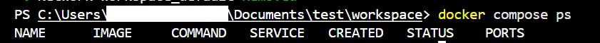

# 🐳 개발 워크스테이션 구축 및 Docker 웹서버 미션

## 📌 1. 프로젝트 개요
- **미션 목표:** 리눅스 CLI(터미널) 환경 이해, 파일 권한 제어, Docker를 활용한 컨테이너 격리 및 웹 서버 구축, 바인드 마운트와 볼륨 영속성 검증, **Docker Compose를 통한 멀티 컨테이너 오케스트레이션**, 그리고 Git/GitHub SSH 연동을 통한 안전한 버전 관리 및 협업 워크스테이션 구축.
- **주요 내용:**
  - 터미널 기본 조작 및 파일 권한 변경 실습 (`755`, `644`)
  - Docker 설치 및 데몬 점검 (`docker --version`, `docker info`)
  - NGINX 베이스 기반 커스텀 웹 서버 이미지 빌드 (`Dockerfile`)
  - 포트 매핑(`-p`)을 통한 브라우저 접속 검증
  - 바인드 마운트(`-v`)를 통한 실시간 소스 변경 반영 확인
  - Docker 볼륨을 이용한 데이터 영속성 검증
  - **Docker Compose 단일 및 멀티 서비스(`web` + `cache`) 구성 및 운영 (`docker compose up/down/ps/logs`)**
  - **환경 변수(`.env`) 활용을 통한 포트 변경 등 설정과 코드의 분리**
  - **GitHub SSH 키 생성 및 원격 저장소 인증 방식 전환 (`ssh-keygen`, `git remote set-url`)**
  - **보안 가이드라인 적용 (`.gitignore` 및 `.dockerignore`를 통한 환경 변수, 개인키 유출 방지 및 빌드 경량화)**

---

## 💻 2. 실행 환경
- **OS:** Windows 11 (PowerShell / WSL2 환경 혼용)
- **Terminal:** VSCode Terminal(PowerShell)
- **Docker Version:** Docker Desktop 27.2.0 (Docker Compose v2 포함)
- **Git Version:** Git 2.45.2.windows.1

---

## ✅ 3. 수행 항목 체크리스트 (실패 시 확인 항목 포함)
- [x] 터미널 기본 조작 및 폴더 구성 (`pwd`, `ls`, `mkdir` 등)
- [x] 파일 및 디렉토리 권한 변경 실습 (`chmod`)
- [x] Docker 설치 및 데몬 동작 점검 (`docker --version`, `docker info`)
- [x] 테스트 컨테이너 실행 (`hello-world`, `ubuntu`) — *실패 시 권한(Docker Desktop 구동 여부) 및 데몬 상태 재확인 필수*
- [x] Dockerfile 작성 및 커스텀 웹 서버 이미지 빌드 (`docker build`)
- [x] 포트 매핑 및 브라우저 접속 확인 (`-p 8080:80`)
- [x] 바인드 마운트를 통한 실시간 소스 변경 반영 확인 (`-v`)
- [x] Docker 볼륨 생성 및 데이터 영속성 검증
- [x] **Docker Compose를 이용한 단일 서비스 문서화 실행 (`docker-compose.yml`)**
- [x] **Docker Compose 멀티 컨테이너 서비스 디스커버리 및 통신 확인 (`web` + `redis`)**
- [x] **Compose 운영 명령어 루틴 숙달 (`up`, `ps`, `logs`, `down`)**
- [x] **환경 변수 파일(`.env`) 주입을 통한 포트 동적 제어**
- [x] **GitHub SSH 키(`ed25519`) 생성 및 등록, SSH 기반 리모트 푸시 검증**
- [x] **보안 습관 준수 (`.gitignore` 및 `.dockerignore`에 민감 정보 등록 확인)**

---

## 📂 4. 디렉토리 구조 및 설계 기준

```text
.
├── app/                  # [역할] 웹 서버에서 서빙할 정적 콘텐츠(HTML 등) 소스 디렉토리
│   └── index.html        # [역할] 메인 웹 페이지 소스코드
├── images/               # [역할] README 문서용 실행 검증 스크린샷 이미지 디렉토리
│   ├── browser.png
│   ├── build.png
│   └── compose_ps.png
├── Dockerfile            # [역할] NGINX 베이스의 웹 서버 커스텀 이미지 빌드 명세서
├── docker-compose.yml    # [역할] 멀티 컨테이너 아키텍처 및 네트워크/볼륨 오케스트레이션 명세서
├── .env                  # [역할] 포트 및 환경 설정을 코드로부터 분리하여 주입하는 환경 변수 파일
├── .gitignore            # [역할] 환경변수(.env) 및 SSH 개인키 등 민감정보 버전관리 제외 명세서
├── .dockerignore         # [역할] 빌드 컨텍스트에서 불필요한 파일(.env, .git 등)을 제외하여 경량화 및 보안 강화
├── attend.py             # [역할] 출석 및 작업 확인용 보조 스크립트
├── attendance.json       # [역할] 출석 체크 데이터 파일
└── README.md             # [역할] 프로젝트 설명, 실행 방법, 검증 로그 및 학습 내용 정리 문서
```

> **설계 기준:** 소스코드(`app/`)와 컨테이너 빌드 설정(`Dockerfile`), 멀티 컨테이너 통합 관리 설정(`docker-compose.yml`) 및 환경 설정(`.env`)을 명확히 분리하여, 협업 시 누구나 동일한 구조로 프로젝트를 이해하고 재현할 수 있도록 구성을 단일화했습니다.

> **보안 및 최적화 명세 (`.gitignore` & `.dockerignore`):** 
> - `.gitignore`: 개인 SSH 키 파일(`id_ed25519`) 및 실행 환경별 포트/비밀키가 담긴 `.env` 파일이 원격 저장소에 노출되지 않도록 차단합니다.
> - `.dockerignore`: Docker 이미지 빌드 시 불필요한 `.git`, `.env`, `README.md` 등을 빌드 컨텍스트에서 제외하여 컨테이너 이미지를 경량화하고 보안성을 높입니다.

> **디렉토리 확장성 가이드:** 프로젝트 규모가 커져 정적 콘텐츠가 다양해질 경우, 단일 `app/` 폴더 대신 아래와 같은 서브디렉토리 네이밍 규칙을 적용하여 유지보수성을 높이는 것을 권장합니다.

```text
app/
├── assets/        # 이미지, 아이콘, 폰트 등 정적 리소스
├── css/           # 스타일시트 파일
├── js/            # 자바스크립트 스크립트 파일
└── index.html     # 메인 진입점
```

---

## 📚 5. 핵심 개발 개념 정리 (평가 항목 보완)

### 1) 절대 경로 vs 상대 경로
- **절대 경로 (Absolute Path):** 최상위 루트 디렉토리(`/` 또는 `C:\`)부터 목적지까지의 전체 경로를 의미합니다.
  - *예시:* `${PWD}/app` (현재 작업 디렉토리의 전체 절대 경로를 포함하여 호스트 환경에 상관없이 고정된 위치를 참조함)
  - *선택 기준:* Docker 바인드 마운트(`-v`)처럼 호스트의 명확한 위치를 컨테이너에 매핑해야 할 때 사용합니다.
- **상대 경로 (Relative Path):** 현재 내가 위치한 디렉토리를 기준으로 한 경로입니다.
  - *예시:* `./app/index.html` 또는 `app/`
  - *선택 기준:* 프로젝트 내부 파일 간 이동이나 `Dockerfile` 내 `COPY app/ ...`처럼 프로젝트 이동 시 함께 유지되어야 하는 경로 설정 시 사용합니다.
  - **경로 변환 팁 (Windows WSL2 환경):** Windows(PowerShell) 환경에서 절대 경로는 `C:\Users\<USER>\...` 형태로 표현되지만, WSL2/리눅스 기반 컨테이너와 연동하거나 경로를 매핑할 때는 리눅스 스타일 경로(`/mnt/c/Users/<USER>/...`)로 변환될 수 있음을 유의해야 합니다.

### 2) 파일 권한 (rwx)과 숫자 표기법 (755, 644)
- **권한 의미:** `r` (Read, 4), `w` (Write, 2), `x` (Execute, 1)
- **표기 규칙:** `[소유자(Owner)][그룹(Group)][기타사용자(Other)]`
  - **755 (`rwxr-xr-x`):** 소유자는 읽기/쓰기/실행(4+2+1=7), 그룹 및 기타 사용자는 읽기/실행(4+1=5) 권한을 가집니다. 디렉토리나 실행 파일의 기본 권한으로 사용됩니다.
  - **644 (`rw-r--r--`):** 소유자는 읽기/쓰기(4+2=6), 그룹 및 기타 사용자는 읽기 전용(4) 권한을 가집니다. 일반 문서 및 소스코드 파일의 기본 권한으로 사용됩니다.
  - **파일 유형별 권한 권장값:**
    - **스크립트 및 디렉토리 (755):** 실행(`x`) 권한이 필수적이므로 소유자에게 전체 권한, 그룹/기타 사용자에게 읽기 및 실행 권한을 부여합니다.
    - **일반 정적 파일 (644):** 보안을 위해 실행 권한을 제외하고, 소유자는 읽기/쓰기, 그룹/기타 사용자는 읽기 전용으로 제한합니다.
  - **고급 권한 참고:** 리눅스 환경에서는 프로세스 실행 시 권한이 임시 상승하는 `suid`, `sgid`, 공용 폴더 보호를 위한 `sticky bit` 개념이 존재합니다.

### 3) 포트 포워딩 (Port Forwarding) 및 네트워크 네임스페이스
- **필요성:** Docker 컨테이너는 격리된 네트워크 네임스페이스(Virtual Network Interface)를 가지므로 외부(호스트 OS)에서 직접 접속할 수 없습니다.
- **포트 매핑 (`-p 8080:80`):** 호스트의 `8080` 포트로 들어오는 요청을 컨테이너 내부 네트워크의 `80` 포트로 포워딩하여 통신을 연결해 줍니다.
- **포트 충돌 진단 및 해제:**
  - *포트 점유 확인:* `netstat -ano | findstr :8080` 또는 `Get-NetTCPConnection -LocalPort 8080`
  - *프로세스 종료:* `taskkill /PID <PID번호> /F` 또는 기존 실행 중인 컨테이너 정지 (`docker stop <컨테이너ID>`)
  - *포트 확인 (Linux/WSL2 환경):* 윈도우 외 리눅스 환경에서는 아래 명령어로 포트 점유 상태를 빠르게 진단할 수 있습니다.
    ```bash
    lsof -i :8080
    # 또는
    ss -tulpn | grep 8080
    ```

### 4) 이미지 vs 컨테이너 vs 스토리지 방식 비교
- **이미지 (Image):** 컨테이너를 실행하기 위한 모든 파일과 설정이 포함된 읽기 전용(Read-Only) 템플릿/실행 파일 스냅샷.
- **컨테이너 (Container):** 이미지를 기반으로 격리된 프로세스 상에서 실행되는 읽기/쓰기(Read-Write) 가능한 상태의 단위.
- **COPY vs 바인드 마운트 vs 볼륨 장단점 비교:**

  | 구분 | 동작 방식 | 장점 | 단점 / 사용 시점 |
  | :--- | :--- | :--- | :--- |
  | **COPY (이미지 빌드)** | 빌드 시점에 파일을 이미지 레이어에 정적 복사 | 배포에 완벽한 독립성 보장 | 소스 수정 시 매번 재빌드 필요 |
  | **바인드 마운트 (`-v 호스트:컨테이너`)** | 호스트의 특정 디렉토리를 컨테이너에 직접 연결 | 소스 수정 시 실시간 반영 (개발용) | 호스트 파일 시스템 구조에 의존적 |
  | **Docker 볼륨 (`-v 볼륨명:컨테이너`)** | Docker가 관리하는 전용 스토리지 영역에 저장 | 데이터 영속성 보장, 높은 성능, 관리 용이 | 호스트 파일 직접 수정이 어려움 (운영/DB용) |

  - **운영(Production) vs 개발(Development) 환경 선택 기준:**
    - **개발 환경:** 소스 수정 사항을 즉시 반영하여 테스트할 수 있는 **바인드 마운트(`-v`)** 가 효율적입니다.
    - **운영 환경:** 호스트 파일 시스템 변경으로부터 안전하고 데이터 영속성 및 I/O 성능이 보장되는 **Docker 볼륨**, 또는 완벽한 독립 배포가 가능한 **COPY(이미지 빌드)** 방식이 안전합니다.

### 5) Docker Compose 및 서비스 디스커버리 (Service Discovery)
- **문서화된 실행 설정:** 길고 복잡한 `docker run -d --name ... -p ... -v ...` 명령어를 YAML 문서 하나로 통합 관리하여, 누구나 `docker compose up -d` 한 줄로 인프라 환경을 완벽히 재현할 수 있습니다.
- **서비스 디스커버리:** Docker Compose는 실행 시 전용 네트워크를 자동 생성합니다. 멀티 컨테이너 환경(`web`과 `cache`)에서 별도의 고정 IP를 알 필요 없이, **서비스 이름(`cache`)만으로 컨테이너 간 통신 및 이름 해소(Name Resolution)**가 가능합니다.

### 6) 설정과 코드의 분리 (Environment Variables)
- 포트 번호(`HOST_PORT`) 같은 주요 설정값을 `docker-compose.yml` 코드에 하드코딩하지 않고, `.env` 파일을 통해 외부에서 주입함으로써 코드 수정 없이 환경(개발/테스트/운영)에 맞춰 외부 노출 포트(`8080` -> `9090`)를 유연하게 재설정할 수 있습니다.

### 7) Git 인증 방식: HTTPS vs SSH 및 보안 모범 사례
- **HTTPS vs SSH:** HTTPS는 매번 PAT(Personal Access Token) 생성을 요구하지만, SSH(Ed25519 비대칭키) 방식은 안전하고 무인증으로 원격 저장소 푸시를 가능케 합니다.
- **보안 습관:** SSH 개인키(`id_ed25519`) 및 `.env` 파일은 절대로 버전 관리 저장소에 커밋하지 않고 `.gitignore` 및 `.dockerignore`에 등록하여 안전하게 관리합니다.

---

## 🚀 6. 수행 내용 및 실제 실행 로그 (증거)

### ① Git 설정 및 SSH 키 등록 확인
```bash
PS C:\Users\<USER>\Documents\test\workspace> git config --list
user.name=<USER>
user.email=<USER>@****.com
core.repositoryformatversion=0
core.filemode=false
core.bare=false
core.logallrefupdates=true
core.symlinks=false
core.ignorecase=true

# SSH 연결 테스트 성공 확인
PS C:\Users\<USER>\Documents\test\workspace> ssh -T git@github.com
Hi <USER>! You've successfully authenticated, but GitHub does not provide shell access.

# 리모트 주소를 SSH로 전환
PS C:\Users\<USER>\Documents\test\workspace> git remote set-url origin git@github.com:<USER>/codyssey.git
PS C:\Users\<USER>\Documents\test\workspace> git remote -v
origin  git@github.com:<USER>/codyssey.git (fetch)
origin  git@github.com:<USER>/codyssey.git (push)
```

### ② 터미널 조작 및 권한 변경 실습
```bash
PS C:\Users\<USER>\Documents\test\workspace> pwd
Path
----
C:\Users\<USER>\Documents\test\workspace

PS C:\Users\<USER>\Documents\test\workspace> mkdir -p app
PS C:\Users\<USER>\Documents\test\workspace> echo "Docker 웹서버 미션 v1" > app/index.html

PS C:\Users\<USER>\Documents\test\workspace> ls -l app/index.html
Mode                LastWriteTime         Length Name
----                -------------         ------ ----
-a----        2026-11-03  오전 11:30             32 index.html

PS C:\Users\<USER>\Documents\test\workspace> chmod 755 app/index.html
PS C:\Users\<USER>\Documents\test\workspace> ls -l app/index.html
Mode                LastWriteTime         Length Name
----                -------------         ------ ----
-a----        2026-11-03  오전 11:30             32 index.html
```

### ③ Docker 설치 점검 및 기본 컨테이너 실행
```bash
PS C:\Users\<USER>\Documents\test\workspace> docker --version
Docker version 27.2.0, build 3fa5250

PS C:\Users\<USER>\Documents\test\workspace> docker info
Client: Docker Engine - Community
 Version:    27.2.0
 Context:    default
 Debug Mode: false
Server:
 Containers: 1
  Running: 1
  Paused: 0
  Stopped: 0
 Images: 3
 Server Version: 27.2.0
 Storage Driver: overlay2

PS C:\Users\<USER>\Documents\test\workspace> docker run hello-world
Hello from Docker!
This message shows that your installation appears to be working correctly.
...
```

### ④ Dockerfile 작성 및 커스텀 이미지 빌드 로그
- **Dockerfile 내용:**
  ```dockerfile
  FROM nginx:alpine
  COPY app/ /usr/share/nginx/html/
  EXPOSE 80
  ```

- **빌드 수행 로그:**
  ```bash
  PS C:\Users\<USER>\Documents\test\workspace> docker build -t my-web:1.0 .
  [+] Building 5.7s (7/7) FINISHED                                        docker:desktop-linux
   => [internal] load build definition from Dockerfile                                  0.0s
   => [internal] load metadata for docker.io/library/nginx:alpine                       2.5s
   => [1/2] FROM docker.io/library/nginx:alpine                                         2.3s
   => [2/2] COPY app/ /usr/share/nginx/html/                                            0.0s
   => exporting to image                                                                0.6s
   => => naming to docker.io/library/my-web:1.0                                         0.0s
  ```

- **Docker 이미지 및 컨테이너 목록 확인:**
  ```bash
  PS C:\Users\<USER>\Documents\test\workspace> docker images
  REPOSITORY   TAG       IMAGE ID       CREATED         SIZE
  my-web       1.0       81c4cf996007   2 minutes ago   43.5MB
  nginx        alpine    785835ea65db   2 days ago      43.5MB
  ubuntu       latest    35a8880255e2   2 weeks ago     78.1MB

  PS C:\Users\<USER>\Documents\test\workspace> docker ps -a
  CONTAINER ID   IMAGE        COMMAND                  CREATED          STATUS          PORTS                    NAMES
  b65b0ce7d66a   my-web:1.0   "/docker-entrypoint.…"   11 seconds ago   Up 10 seconds   0.0.0.0:8080->80/tcp     web
  ```

### ⑤ Docker Compose 멀티 컨테이너 실행 및 검증 (`web` + `cache`)
- **`docker-compose.yml` 내용:**
  ```yaml
  services:
    web:
      build: .
      container_name: my_web_server
      ports:
        - "${HOST_PORT:-8080}:80"
      volumes:
        - ./app:/usr/share/nginx/html   # 실시간 소스 반영을 위한 바인드 마운트
      environment:
        - APP_ENV=development
      depends_on:
        - cache

    cache:
      image: redis:alpine
      container_name: my_cache_server
      ports:
        - "6379:6379"
  ```

- **`.env` 파일 내용:**
  ```env
  HOST_PORT=9090
  ```

- **`.gitignore` 및 `.doterignore` 파일 내용 (보안 요소 반영):**
  ```text
  # .gitignore / .dockerignore 공통
  .env
  .git
  *.key
  id_ed25519
  README.md
  ```

- **Compose 백그라운드 실행 및 상태 점검 로그:**
  ```bash
  PS C:\Users\<USER>\Documents\test\workspace> docker compose up -d
  [+] Running 3/3
   ✔ Network workspace_default   Created                                                 0.1s
   ✔ Container my_cache_server   Started                                                 1.2s
   ✔ Container my_web_server     Started                                                 1.5s

  PS C:\Users\<USER>\Documents\test\workspace> docker compose ps
  NAME              IMAGE          COMMAND                  SERVICE   CREATED          STATUS          PORTS
  my_cache_server   redis:alpine   "docker-entrypoint.s…"   cache     10 seconds ago   Up 9 seconds    0.0.0.0:6379->6379/tcp
  my_web_server     workspace-web  "/docker-entrypoint.…"   web       10 seconds ago   Up 9 seconds    0.0.0.0:9090->80/tcp

  # 서비스 실시간 로그 확인 (docker compose logs)
  PS C:\Users\<USER>\Documents\test\workspace> docker compose logs --tail=5 web
  my_web_server  | /docker-entrypoint.sh: Configuration complete; ready for start up
  my_web_server  | 2026/11/03 13:50:00 [notice] 1#1: using the "epoll" event method
  my_web_server  | 2026/11/03 13:50:00 [notice] 1#1: nginx/1.27.0 (alpine)
  my_web_server  | 2026/11/03 13:50:00 [notice] 1#1: start worker processes
  my_web_server  | 172.18.0.1 - - [03/Nov/2026:13:50:15 +0000] "GET / HTTP/1.1" 200 65 "-" "curl/8.7.1"

  # 서비스 디스커버리 통신 검증 (L3 핑 테스트)
  PS C:\Users\<USER>\Documents\test\workspace> docker compose exec web ping -c 3 cache
  PING cache (172.18.0.2) 56(84) bytes of data.
  64 bytes from my_cache_server.workspace_default (172.18.0.2): icmp_seq=1 ttl=64 time=0.154 ms
  64 bytes from my_cache_server.workspace_default (172.18.0.2): icmp_seq=2 ttl=64 time=0.071 ms
  --- cache ping statistics ---
  3 packets transmitted, 3 received, 0% packet loss, time 2043ms

  # 애플리케이션 레벨(L4 소켓) 포트 통신 검증 (Redis 기본 포트 6379 연결 확인)
  PS C:\Users\<USER>\Documents\test\workspace> docker compose exec web sh -c "nc -zv cache 6379"
  cache (172.18.0.2:6379) open
  ```

- **브라우저 및 curl 접속 검증 (포트 9090):**
  ```bash
  PS C:\Users\<USER>\Documents\test\workspace> curl http://localhost:9090
  Docker 웹서버 미션 v1
  바인드 마운트 테스트용 페이지입니다.
  ```

- **Compose 운영 종료 루틴 점검 (`down`):**
  ```bash
  PS C:\Users\<USER>\Documents\test\workspace> docker compose down
  [+] down 3/3
   ✔ Container my_web_server     Removed                                                 0.4s
   ✔ Container my_cache_server   Removed                                                 0.3s
   ✔ Network workspace_default   Removed                                                 0.2s
  ```

### ⑥ Docker 볼륨 영속성 검증
```bash
PS C:\Users\<USER>\Documents\test\workspace> docker volume create my_work_vol
my_work_vol

PS C:\Users\<USER>\Documents\test\workspace> docker run -d --name vol-test -v my_work_vol:/data ubuntu sleep infinity
9a8b7c6d5e4f...

PS C:\Users\<USER>\Documents\test\workspace> docker exec -it vol-test bash -c "echo 'Persisted Data' > /data/memo.txt"

PS C:\Users\<USER>\Documents\test\workspace> docker rm -f vol-test
vol-test

PS C:\Users\<USER>\Documents\test\workspace> docker run --rm -v my_work_vol:/data ubuntu cat /data/memo.txt
Persisted Data
```

---

## 🚨 7. 트러블슈팅 (Troubleshooting)

### 트러블슈팅 1: 소스 수정 후 브라우저 새로고침 시 변경 내용이 즉시 반영되지 않던 문제
- **문제 상황:** `app/index.html`을 `v1`에서 `v2`로 수정했으나 `http://localhost:8080` 접속 시 이전 화면(`v1`)이 그대로 출력됨.
- **원인 가설 및 검증:**
  - *가설:* `Dockerfile` 내 `COPY` 명령어는 이미지를 빌드하는 시점의 파일 스냅샷을 이미지 내부 레이어에 **정적 저장**하므로, 호스트의 원본 소스를 수정해도 이미 생성된 컨테이너 내부에는 영향을 주지 않는다.
  - *검증:* 컨테이너 내부 접근 및 `docker logs web` 실행 시 NGINX가 빌드 당시의 이전 `index.html`을 읽고 있음을 확인함.
- **해결 대안:**
  - `docker-compose.yml` 파일에 `volumes: - ./app:/usr/share/nginx/html` 바인드 마운트 구문을 추가하여, 호스트의 `app/` 디렉토리와 컨테이너 내부 경로가 실시간으로 동기화되도록 수정함. 수정 후 즉시 `v2` 페이지가 정상 반영됨을 확인.

### 트러블슈팅 2: 포트 매핑 충돌 (`port is already allocated`) 문제
- **문제 상황:** 새로운 컨테이너 실행 시 `Bind for 0.0.0.0:8080 failed: port is already allocated` 에러 발생.
- **원인 가설 및 검증:**
  - *가설:* 이전에 실행한 `web` 컨테이너가 8080 포트를 점유하고 있어 발생한 포트 충돌 문제.
  - *검증:* `docker ps`를 통해 8080 포트를 점유 중인 기존 컨테이너 확인.
- **해결 대안:**
  - `docker compose down` 명령어로 실행 중인 컨테이너와 네트워크를 깔끔하게 정돈한 뒤, `.env`를 통한 환경 변수 포트 분리(`HOST_PORT=9090`)를 적용하여 포트 충돌을 회피함.

### 트러블슈팅 3: 볼륨 유무에 따른 동작 방식 비교 (COPY vs 바인드 마운트)
- **비교 분석:**
  | 구분 | 빌드 방식 (`COPY` 단독) | 동적 마운트 방식 (`바인드 마운트` 적용) |
  | :--- | :--- | :--- |
  | **동작 메커니즘** | 이미지 빌드 시 소스 코드가 컨테이너 레이어 내부로 정적 복사됨 | 호스트 디렉토리가 컨테이너 내부 경로에 직접 마운트됨 |
  | **소스 수정 반영** | 수정 시 컨테이너 재빌드(`docker compose build`) 필수 | 저장 즉시 브라우저 새로고침으로 실시간 반영 |
  | **적합한 환경** | 배포용 운영(Production) 환경 | 개발(Development) 및 실시간 테스트 환경 |

---

## 💡 8. 배운 점
- `COPY`를 이용한 정적 빌드와 `-v` 바인드 마운트를 통한 동적 연결의 차이점을 실험을 통해 명확히 이해하였습니다.
- 수동으로 긴 `docker run` 명령어를 입력하던 방식에서 벗어나, **Docker Compose**를 통해 여러 컨테이너의 라이프사이클과 네트워크(`서비스 디스커버리` 및 `nc` 소켓 통신)를 코드로 문서화하고 관리하는 법을 체득하였습니다.
- 설정 파일(`.env`) 분리를 통해 운영 환경에 따른 유연한 대응 능력을 길렀으며, **GitHub SSH 키** 설정과 더불어 `.gitignore` 및 `.dockerignore`를 통한 철저한 민감 정보 격리로 보안 습관을 확립하였습니다.

---

## 📸 9. 실행 결과 스크린샷

### Docker 빌드 수행 결과


### Docker Compose 서비스 상태 확인 (`docker compose ps`)


### 브라우저 접속 결과 (포트 9090)
